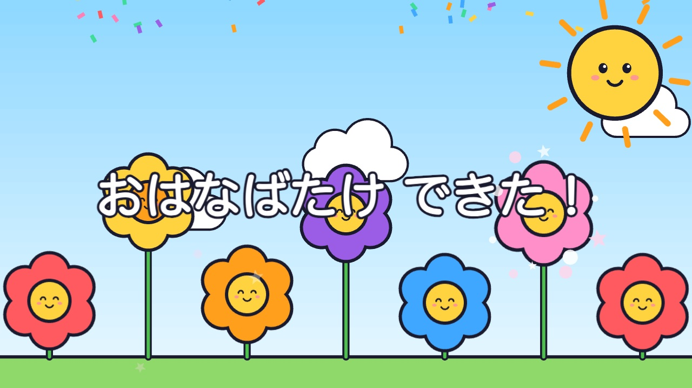
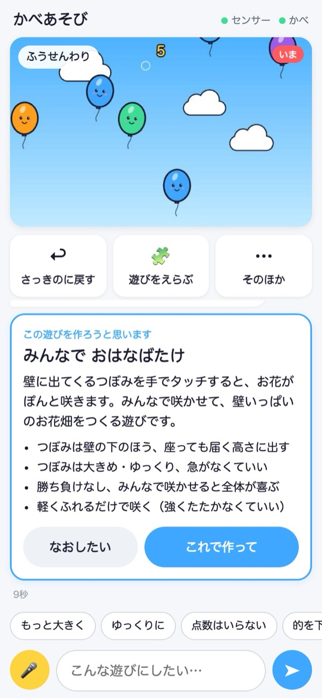
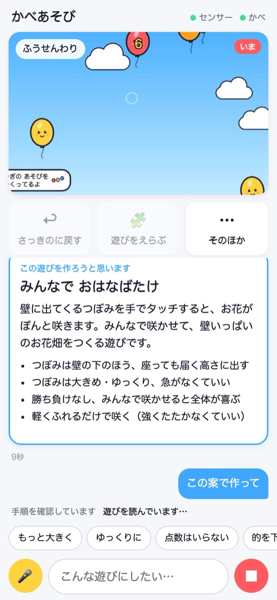
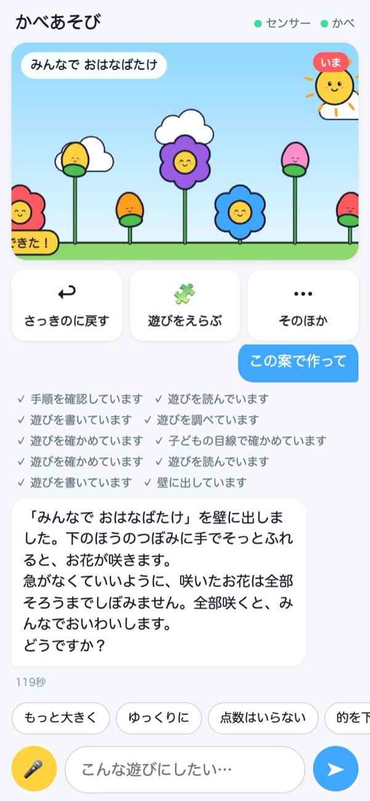
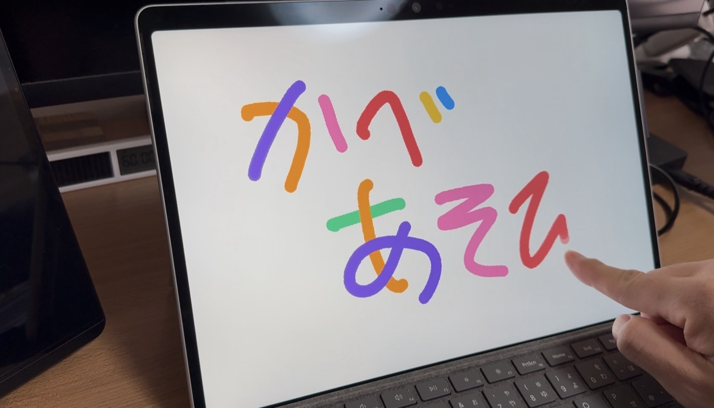

# かべあそび（kabe-asobi）

**児童館の職員が、スマホで話しかけるだけで、その日に遊ぶ子どもに合った「壁の遊び」が立ち上がる。**

壁に短焦点プロジェクターで遊びを映し、測域センサ（2D LiDAR）でボールや手が当たった場所をとらえます。
遊びを作る・直す・壁に合わせる作業は Claude Code が受け持ち、職員はエンジニアでなくても使えます。

> Built with Claude: Japan 2026 の応募作品です。ハッカソン期間中（2026-11-03〜11-08）に、ゼロから Claude Code と作りました。
> デモ動画：（提出時に追加します）

<p align="center"></p>

| 1. スマホで頼む → 案が出る | 2. 「これで作って」→ 作っている間も遊べる | 3. 壁に出た |
|:---:|:---:|:---:|
|  |  |  |

| はかったこと | 値 |
|---|---|
| 話しかけてから新しい遊びが壁に出るまで | 約1.5〜3分（案は約10秒）。本物のセンサーとプロジェクターで10回の実測 |
| 「もっと大きく」などその場の調整 | 値の調整 約10秒、遊び方を変える直し 約40〜50秒 |
| 壁への合わせ込みのずれ | 1.6cm（本物のセンサー、合格の目安 5cm 以内） |
| 「人が近くに立つと反応する」を Claude が自分で調整 | 余計な反応 131回 → 5回（25秒） |
| 1回の頼みごとの費用 | 案 約$0.05〜0.15、遊びを作る 約$0.2〜0.4、調整 約$0.05〜0.2（上限 $3） |

### 5分で試す（センサー・プロジェクターなしで）

```bash
npm install && npm run dev
```

壁の画面（http://127.0.0.1:5173）を**クリックやタップ**すると、ボールや手が当たったことになります。スマホ画面は PC のブラウザでも開けます。`.env` に Claude の APIキーを書くと、本物の Claude に遊びを頼めます。くわしくは [試す（センサーなし）](#試すセンサーなし)。

**English:** *kabe-asobi* lets staff at children's centers create interactive wall games just by talking to Claude on a phone. A short-throw projector draws the game on a wall; a 2D LiDAR (SCIP 2.0) senses where balls and hands hit. Claude Code — through custom Skills, an MCP "wall server", a sub-agent that checks games from a child's point of view, and hooks — writes each game, verifies it automatically, calibrates the projection to the sensor, and tunes it on the spot ("make the targets bigger on the left for the little ones"). Everything is drawn and sounded from code (no external assets), and games that fail verification never reach the wall. Built from scratch during the hackathon; see the [manual](docs/manual.md) (Japanese).

---

## なぜ作ったか

私はシステムベンダーとして、インタラクティブコンテンツ（触れたり、ボールを当てたりすると反応する映像）を作ってきました。それに触れた人の笑顔が、この仕事の喜びです。

でも、こうしたコンテンツは、予算の限られた施設にはなかなか届きません。機材（短焦点プロジェクターと測域センサー）は数十万円で、手の届く範囲になってきました。それでも届かないのは、**機材を置いただけでは使えないから**です。現場ごとに壁もセンサーも違うので、プロが現場に入り、何日もかけて調整する（設置、キャリブレーション、検出の調整、コンテンツの座標合わせ、試験）。コンテンツを入れ替えるたびに、またプロが要る。「今日は小さい子が多い」「車いすの子がいる」といった、その日の子どもに合わせた変更は、現実にはできませんでした。

Claude Code で、誰でもソフトウェアを作れる時代になりました。残っていた壁は、物理の現場に合わせるプロの仕事です。かべあそびは、**作り手が現場で積み上げてきた手順と判断**（壁への合わせ込み、センサーの調整、子ども向けの安全の決まり、遊びの作り方）を Claude Code の Skill・MCP・サブエージェント・フックにして、児童館の職員の手に渡す試みです。

| | これまで | かべあそび |
|---|---|---|
| 現場の調整 | プロが現場で数日（作り手としての経験から） | 職員だけで。キャリブレーションは光った丸を6回タッチするだけ（約5分、ずれ 1.6cm） |
| コンテンツの入れ替え | プロに依頼 | スマホから、その場で十数秒 |
| 日々の遊び1本 | ― | スマホで頼んで約2分（Claude 利用料 数十円から） |

目指すのは、インタラクティブコンテンツの民主化です。エンジニアのいない施設でも、職員が自分たちの子どもに合った遊びを作り、直し、使い続けられるようにします。児童館のほか、学童や保育園など、子どもが集まる場所で同じように使えます。

## 何ができるか

| 職員がすること | かべあそびがすること |
|---|---|
| スマホで「4歳の子が10人。鬼にボールを当てる遊びにして」と話しかける | Claude がまず遊びの案（名前・遊び方・子どもに合わせたところ）をスマホに出す。職員が「これで作って」を押すと作り始め、自動で確かめてから壁に出す。作っている間は、壁の隅に「つぎの あそびを つくってるよ」と出る |
| 「小さい子の側だけ、的を大きくして」と頼む | その場で直して、1分以内に反映する |
| 「さっきのに戻して」と頼む、またはボタンを押す | 前の遊び・前の版にすぐ戻す |
| 「音楽を小さくして」と頼む、またはスマホの「おと」で変える | 音楽（BGM）と効果音の大きさを別々に変える。遊びごとの曲の雰囲気（のんびり・和風など）も変えられる |
| 「遊びをえらぶ」、「そのほか」→「きろく」を開く | 作った遊びを、作った日・きっかけの頼みごと・Claude がそうした理由と一緒に見せる。前に作った遊びをまた壁に出せる |
| 壁に出た光る丸を、順に手でタッチする | 投影とセンサーの位置を合わせ、ずれ（cm）を測って確かめる |

子ども向けの決まり（小さい子には勝ち負けを出さない、ボールの遊びでは壁に近づかなくて済む配置にする、など）は、Claude が必ず守る手順として組み込んであります。
子ども向けでない頼みごと（性的なもの、血や武器で傷つける表現、からかい、既存のキャラクターなど）は作らず、理由を一言伝えて、子ども向けに直した案を出します。作った遊びは、公開の前に検証役（サブエージェント）が画面を見て、同じ点を確かめます。

<p align="center"></p>

作れるのは的当てだけではありません。上は職員役が「壁にお絵描きできる遊び」と頼んで作ったもの。壁の画面はクリックやタッチでも遊べるので、タッチ画面の Windows PC でそのまま動かしています。

## しくみ

```
 [職員のスマホ]  専用の画面（同じWi-Fiの中だけ・合言葉つき）
      │
      ▼
 ┌──────────── PC（Mac／Windows）───────────┐
 │ スマホ画面のサーバー                          │
 │   └ Claude Agent SDK ─ Claude Code            │
 │        Skills・サブエージェント・フック        │
 │        └ 壁サーバー（MCP）─ 検証・公開・戻す   │
 │                                               │
 │ web/games（下書き）─検証に通ったら→ web/live  │
 │                                      │        │
 │ ハブ ── 当たった位置 ──→ 壁の画面（ブラウザ）  │──HDMI→ [プロジェクター] → 壁
 │  ▲                                            │
 └──┼────────────────────────────────────────────┘
    │ LAN（SCIP 2.0）
 [測域センサ]  壁と平行に走査し、ボールや手を見つける
```

- **ハブ**（`src/server/hub.ts`）：センサーの距離データから当たりを見つけ、合わせ込みの結果で画面の座標に直して、壁の画面へ送ります
- **壁の画面**（`web/`）：TypeScript と PixiJS で動く遊び。絵も効果音も BGM もコードで作るので、外部の素材を使いません
- **遊びの枠と部品**（`web/engine/`）：動き（跳ねる・揺れる・まばたきなど）、演出（粒子・紙吹雪）、効果音、BGM（5つの雰囲気）、キャラクター。Claude はこれを組み合わせて、遊びごとの短いコードを書きます
- **センサーの差し替え**：センサーごとの違いは入力アダプタに閉じ込め、遊びは共通の形式（`src/shared/protocol.ts`）だけを受け取ります。今は北陽電機 UST-20LX に対応しています。今後、安価な LiDAR や深度カメラも足せる作りです

## Claude の使い方

| 機能 | 何に使っているか |
|---|---|
| **Claude Code** | 開発の中心。このリポジトリのコードは、ハッカソン期間中に Claude Code と作りました |
| **Claude Agent SDK** | 職員のスマホ画面の裏で、プロジェクトの Claude Code を動かします |
| **Skills**（`.claude/skills/`） | `new-game`（遊びを作る手順・子ども向けの決まり・絵柄のルール）、`calibrate`（壁への合わせ込み）、`tune`（遊んでいる最中の調整）、`sensor-tune`（センサーの記録を分析して当たり検出を調整） |
| **MCP**（`src/mcp/wall-server.ts`） | 自作の「壁サーバー」。センサーの今の様子、壁の画面の撮影、遊びの検証・公開・戻す、値の調整、合わせ込み、センサーの記録の分析と当たり検出の調整 |
| **サブエージェント**（`.claude/agents/game-checker.md`） | 作った遊びのスクリーンショットを、子どもの目線で確かめる検証役（軽量モデル） |
| **フック**（`.claude/settings.json`） | 壁に映っている版の直接編集と危ない操作を止める。遊びを編集したら型チェック |
| **モデルの使い分け** | 職員との会話と遊びの設計は Claude Opus 5.5、検証は軽量モデル |

Claude が画面の中だけで完結せず、センサーの生のデータを読んで、物理の空間に自分で合わせ込むことが、この作品の中心です。
たとえば「人が壁の近くに立つと何度も反応する」と言われると、Claude は記録を流し直して原因を数字で確かめ、調整値を2〜4通り試して、一番よいものを反映します（模擬の記録で、余計な反応 131回 → 5回、ボールは全部拾えたまま、25秒）。

安全のための作り：
- 下書きは自動検証（エラー・FPS・後片付け漏れ・スクリーンショット）に通ったものだけが壁に出ます。壊れた遊びが子どもの前に出ません
- 公開のたびに前の版を保存し、いつでも戻せます
- 職員の画面から動く Claude は、シェルやWebを使えません。1回の頼みごとの費用に上限（$3）があります

## 必要なもの

| もの | 備考 |
|---|---|
| PC | macOS（Apple シリコン）と Windows 11 で確認しています。Windows では、起動・画面のタッチでの遊び・スマホから Claude に頼んで遊びを作り壁に出すまでを確認（本物のセンサーとプロジェクターは Mac で確認）。メモリ 16GB 推奨、空きディスク 2GB ほど |
| ソフト | Node.js 26、Git、Chrome（壁の画面を全画面で映す） |
| ネットワーク | スマホと PC は同じ Wi-Fi に。PC はインターネット（Claude の API）につながること。センサーは PC の有線 LAN へ（Mac・Windows の設定は [docs/sensor-setup.md](docs/sensor-setup.md)） |
| 測域センサ | 北陽電機 UST-20LX（LAN接続）。**なくても模擬センサーで試せます** |
| 短焦点プロジェクター | 壁に投影するため |
| 柔らかいボール | 直径7cm前後 |
| Claude の APIキー | スマホ画面から Claude を使うとき（Claude Console で作るキー）。なくても「仮の相手」で画面を試せます。1回の頼みごとは $0.05〜1 ほど（上限 $3） |

**使い方は、画面の写真つきの [マニュアル（docs/manual.md）](docs/manual.md) にまとめています。**

### 安全のしくみ

- スマホの画面は、PC と同じ Wi-Fi の中から、合言葉つきの URL でだけ開けます（合言葉は起動のたびに変わる。`.env` で固定もできる）。アカウント式のログインは、PC 1台・職員数人の運用では手間が増えるだけなので入れていません
- Claude には、はじめからある遊びの書き換え禁止、`web/live/` の直接編集や危ない操作を止めるフック、子ども向けでない内容を作らない決まり、1回の頼みごとの費用の上限（$3）をかけています
- 検証に通らない遊びは壁に出ません。「さっきのに戻して」でいつでも前の版に戻せます

## 試す（センサーなし）

```bash
npm install
npx playwright install chromium   # 遊びを壁に出す前の自動検証に使う（なければ PC の Google Chrome で代用します）
git config core.hooksPath .githooks
npm run dev
```

- 壁の画面：http://127.0.0.1:5173 （クリックやタップで当たりを起こせます。`?debug=1` で当たりの位置と遅れを表示）
  - `npm run dev` の模擬センサーは静かで、自分で当てたところだけ反応します。模擬の子どもが自動でボールを投げる様子を見たいときは `npm run dev:auto`
- スマホ画面：起動したときに表示される、合言葉つきの URL を開く（パソコンのブラウザでも開けます。横長の画面では、左に壁の様子、右に会話が並びます）
- `?debug=1` をつけて開いたときは、数字キーで遊びを切り替え、Backspace で前の遊びに戻れます（壁に映すときは効きません）

スマホ画面から本物の Claude を使うには、APIキーを `.env` に書きます。

1. [Claude Console](https://console.anthropic.com/) で APIキーを作る
2. リポジトリのいちばん上のフォルダで、見本をコピーして `.env` を作る
   - Mac：`cp .env.example .env`
   - Windows（コマンド プロンプト）：`copy .env.example .env`
3. `.env` をテキストエディタで開き、`sk-ant-...` を自分のキーに置き換えて保存する
4. `npm run dev` を起動し直す。スマホ画面の左上の「仮」が消えれば、本物の Claude につながっています

`.env` はリポジトリに入りません。キーは `.env` 以外（シェルの環境変数など）には書かないでください。

```
ANTHROPIC_API_KEY=sk-ant-...
# 任意。スマホ画面の合言葉を固定する（職員が URL を一度保存すれば済むように）
KABE_PHONE_KEY=asobi-2026
```

## 本物のセンサーで使う

1. センサーと PC を LAN でつなぎ、`npm run sensor:check` で通信を確かめる（手順：[docs/sensor-setup.md](docs/sensor-setup.md)、はじめての日の要点は [チェックリスト](docs/sensor-checklist.md)）
2. `npm run dev:lidar` で起動する
3. スマホ画面の「そのほか」→「壁に合わせる」を押し、壁に出た丸を順にタッチする

## 開発者向け

| コマンド | 内容 |
|---|---|
| `npm test` | 単体テスト（模擬センサーでの当たり検出の精度、合わせ込み、SCIP 2.0 の解析） |
| `npm run verify -- <id> --draft` | 遊びの下書きの自動検証 |
| `npm run smoke` / `smoke:calib` / `smoke:phone` | 壁サーバー・合わせ込み・スマホ画面の通し確認 |
| `npm run record -- <名前>` | センサーの記録（`recordings/`） |
| `npm run fake-sensor` | 模擬の SCIP サーバー（センサーなしで接続まわりを試す） |
| `npx tsx tools/make-sample.ts` | 調整の練習用に、わざと難しくした模擬の記録を作る（正解つき） |
| `npx tsx tools/tune-smoke.ts` | センサー調整の道具の通し確認 |

新しい遊びは `web/games/<id>.ts` に書きます。見本は `web/games/balloons.ts` です。部品の一覧は `.claude/skills/new-game/reference.md` にあります。

詳しい要件と設計の判断は [docs/requirements.md](docs/requirements.md)、作業の記録は [PROGRESS.md](PROGRESS.md) にあります。

## いまの状態

- 本物のセンサー（UST-20LX）と短焦点プロジェクターで、合わせ込み・遊び・その場の調整・新しい遊びの作成まで一通り動かしました。合わせ込みのずれは 1.6cm（合格の目安 5cm 以内）。新しい遊びは頼んでから約1.5〜3分で壁に出ます（10回の実測）。模擬センサーでは当たりのほぼ100%を拾い、ずれは中央値 0.8cm でした
- 本物の Claude で、スマホ画面から次の流れを確かめています
  - 頼む → 案が出る（約10秒）→「これで作って」→ 検証して壁に出る（約1.5〜3分）
  - 「もっと大きく」「左側を小さい子用に」などのその場の調整（約10秒）
  - センサーの記録の分析と当たり検出の調整（約25秒）
  - 子ども向けでない頼みを断って、代わりの案を出す
- 見本の遊びは10（ふうせんわり、どうぶつ おんがくたい、くもを はらそう、シャボンだま ぱちん！、おにはそと！、あか・あお ふうせん たいけつ、おつきみ うさぎ、さわって さかせよう おはなばたけ、みんなで おはなばたけ、おさかな すいすい）。おつきみ うさぎ と 花の遊び2つは、スマホから本物の Claude に頼んで作ったもの
- Windows 11 でも、起動からスマホで頼んで遊びが壁に出るまでを確認しました。タッチ画面の PC では、壁の画面をそのままタッチして遊べます
- これから：起動はコマンド操作（`npm run dev:lidar`）で、スマホ用の URL は PC の画面に出ます。職員が一人で立ち上げられるように、ダブルクリックで起動する入口と、壁に QR コードを出す機能を次に入れます

## ライセンス

[Apache License 2.0](LICENSE)。自由に使い、直し、配れます（改変して配るときは、変更した旨を明記してください）。
