# かべあそび 使い方マニュアル

児童館などの職員の方が、スマホで話しかけるだけで、その日の子どもに合った「壁の遊び」を作り、遊んでいる最中に直せるようにする道具です。
このマニュアルは、毎日使う職員の方（1〜8章）と、機材を準備する方（0章・9章）に向けて書いています。

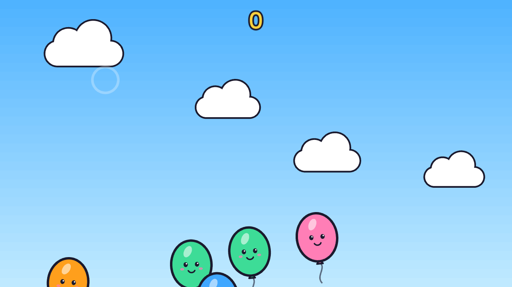

*壁に映した遊びの例（ふうせんわり）。ボールや手が当たった場所を、センサーがとらえます。*

> 画面の写真は、本物の Claude で操作したときのものです（センサーは模擬の入力）。Claude が作る遊びや返事の言葉は、頼むたびに少しずつ変わります。

---

## もくじ

0. [はじめる前に（準備する方へ）](#0-はじめる前に準備する方へ)
1. [スマホの画面の見かた](#1-スマホの画面の見かた)
2. [新しい遊びを頼む](#2-新しい遊びを頼む)
3. [遊んでいる最中に直す](#3-遊んでいる最中に直す)
4. [前の遊びに戻す・遊びをえらぶ](#4-前の遊びに戻す遊びをえらぶ)
5. [そのほか（おと・きろく・壁に合わせる・新しい会話）](#5-そのほかおときろく壁に合わせる新しい会話)
6. [子ども向けでない頼みごと](#6-子ども向けでない頼みごと)
7. [パソコンで使う](#7-パソコンで使う)
8. [頼み方のコツ](#8-頼み方のコツ)
9. [困ったとき](#9-困ったとき)
10. [付録：裏側の画面（説明や発表のとき）](#10-付録裏側の画面説明や発表のとき)

---

## 0. はじめる前に（準備する方へ）

### つなぎ方

| もの | つなぐ先 |
|---|---|
| PC（Mac） | すべての中心。遊びを動かし、Claude とやりとりします |
| 短焦点プロジェクター | PC と HDMI でつなぎ、壁に映します |
| 測域センサ | PC と LAN ケーブルでつなぎます（手順：[sensor-setup.md](sensor-setup.md)） |
| 職員のスマホ | PC と**同じ Wi-Fi** につなぎます |

### 起動する

PC のターミナルで、次のどちらかを実行します。

```bash
npm run dev:lidar   # センサーをつないで使うとき
npm run dev         # センサーなしで試すとき（模擬の入力）
```

起動すると、次の2つの URL が表示されます。

- **壁の画面**：`http://127.0.0.1:5173` … プロジェクターに映す画面です。ブラウザで開き、全画面にします（Mac の Chrome なら `control + command + F`）
- **スマホの画面**：「同じ Wi-Fi のスマホから」と書かれた URL … 合言葉（`k=` の後ろ）がついています。これを職員のスマホで開きます

### 気をつけること

- スマホの画面は、**同じ Wi-Fi の中**から、**合言葉つきの URL** でだけ開けます。一度開くと、そのスマホでは24時間、合言葉なしで開けます
- 合言葉は起動のたびに変わります。固定したいときは `npm run phone -- --key <好きな合言葉>` で起動します
- ゲスト用の Wi-Fi は、端末どうしが通信できないことがあります。つながらないときは別の Wi-Fi を使ってください
- スマホでは、URL を開いたあとに「ホーム画面に追加」しておくと、次からアイコンで開けます
- 本物の Claude を使うには、PC の `.env` に APIキーが必要です。ない場合は「仮」の相手で画面の操作だけ試せます（画面の左上に「仮」と出ます）

### 壁に合わせる（はじめて置いたとき・プロジェクターを動かしたとき）

センサーとプロジェクターを置いたら、最初に一度「壁に合わせる」をします。スマホの「そのほか」→「壁に合わせる」から始めます（[5章](#壁に合わせる)）。

---

## 1. スマホの画面の見かた

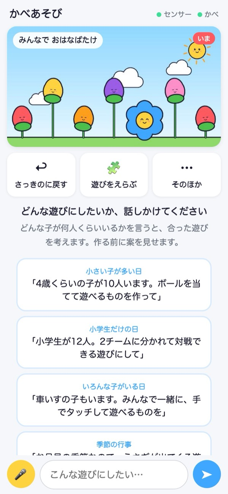

| 場所 | 何があるか |
|---|---|
| いちばん上の右 | **センサー**・**かべ** の丸。緑ならつながっています。赤のときは [9章](#9-困ったとき) を見てください |
| 壁の小さな画面 | 壁にいま映っているもの（1〜2秒ごとに変わります）。左上が遊びの名前 |
| 3つのボタン | **さっきのに戻す**（前の遊びに戻す）、**遊びをえらぶ**（作った遊びの一覧）、**そのほか**（音・記録・壁に合わせる など） |
| まん中 | Claude との会話。はじめて開いたときは、**頼み方の例**が4つ出ます。押すと、その言葉でそのまま頼めます |
| いちばん下 | 🎤（話して頼む）、文字の入力、➤（送る） |

---

## 2. 新しい遊びを頼む

新しい遊びは、**①頼む → ②案を確かめる → ③作る → ④壁に出る** の順に進みます。
Claude は、いきなり作り始めません。まず案を見せるので、職員が確かめてから作ります。

### ① 頼む

文字で打つか、🎤 を押して話します。**どんな子が・何人くらい・何をしたいか**を入れると、合った遊びを考えます。

> 例：「車いすの子もいます。みんなで一緒に、手でタッチして遊べるものを作って」

### ② 案を確かめる（10秒ほど）

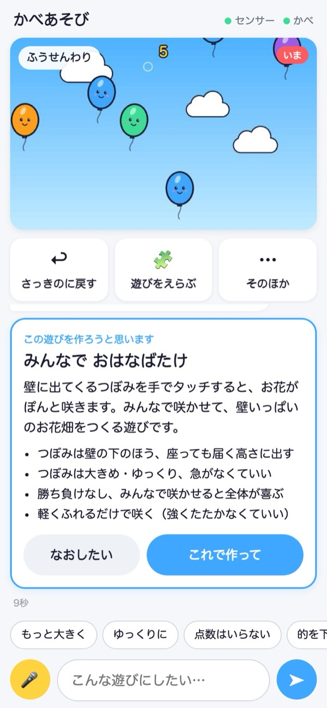

Claude が「この遊びを作ろうと思います」というカードを出します。遊びの名前、遊び方、子どもに合わせたところが書いてあります。

| ボタン | すること |
|---|---|
| **これで作って** | この案で作り始めます |
| **なおしたい** | 入力の欄に移ります。「つぼみをもっと少なく」「音楽はにぎやかに」など、直したいことを書いて送ると、案を出し直します |

この段階では、まだ壁は変わりません。費用は約0.1ドルです。

### ③ 作っている間（2〜5分ほど）

<table>
<tr>
<td>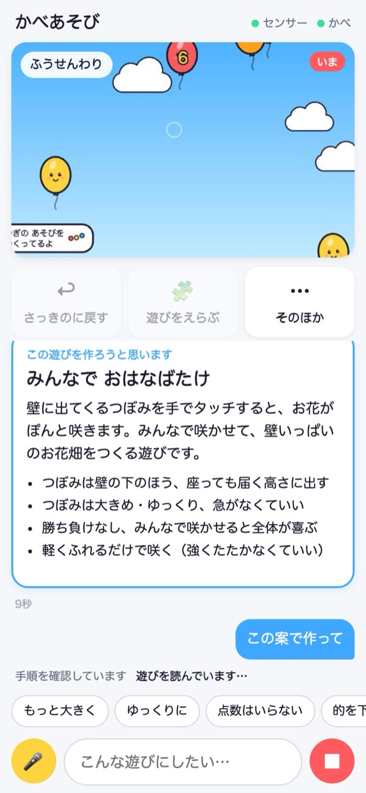</td>
<td>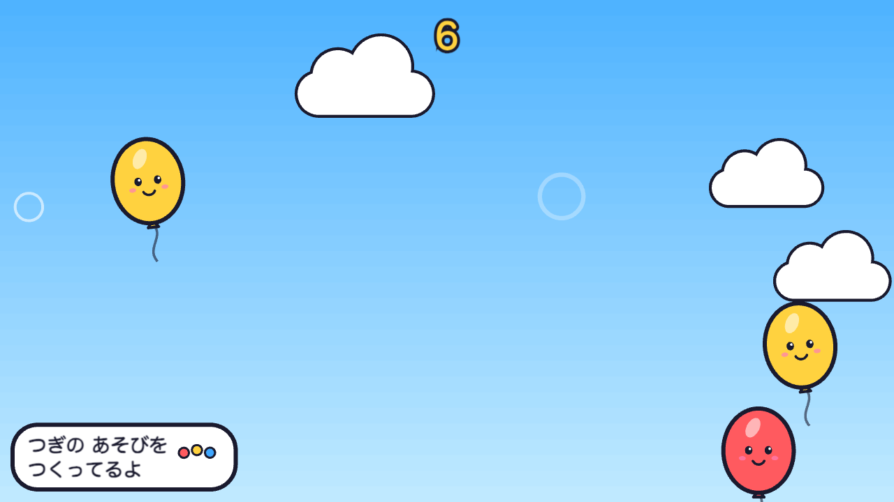</td>
</tr>
<tr>
<td><em>スマホ：いま何をしているかが、下に順に出ます</em></td>
<td><em>壁：左下に「つぎの あそびを つくってるよ」が出ます</em></td>
</tr>
</table>

- 作っている間も、**いまの遊びはそのまま遊べます**。子どもを待たせなくて済みます
- 壁の左下に「つぎの あそびを つくってるよ」が出るので、子どもにも「次の遊びが来る」と分かります
- Claude は作ったあと、自分で動かして確かめ、検証役（子どもの目線で画面を見る係）の確認にも通してから、壁に出します。確認に通らない遊びは壁に出ません
- やめたいときは、右下の赤い ■ を押します

### ④ 壁に出る

<table>
<tr>
<td>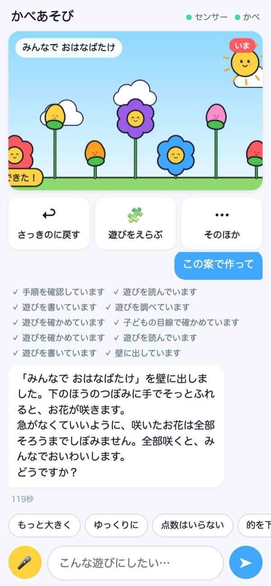</td>
<td>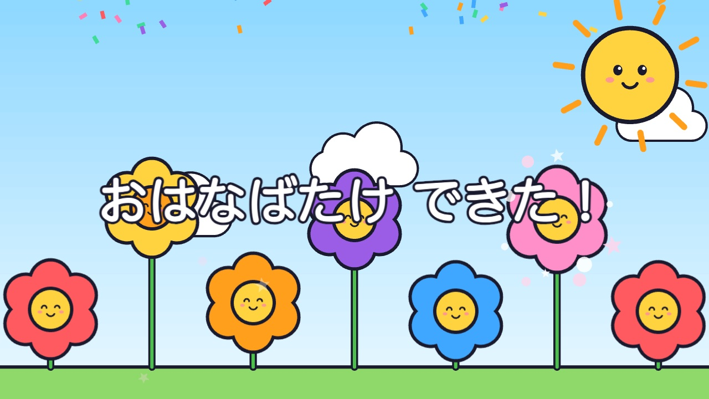</td>
</tr>
<tr>
<td><em>スマホ：何を作ったか、どう遊ぶかが返事で届きます</em></td>
<td><em>壁：新しい遊びに切り替わります（左下に「できた！」）</em></td>
</tr>
</table>

壁が新しい遊びに切り替わると、左下に「できた！」が少しだけ出て消えます。
この例では、つぼみを壁の下のほう（座っていても届く高さ）に大きめに並べ、勝ち負けのない遊びになっています。

---

## 3. 遊んでいる最中に直す

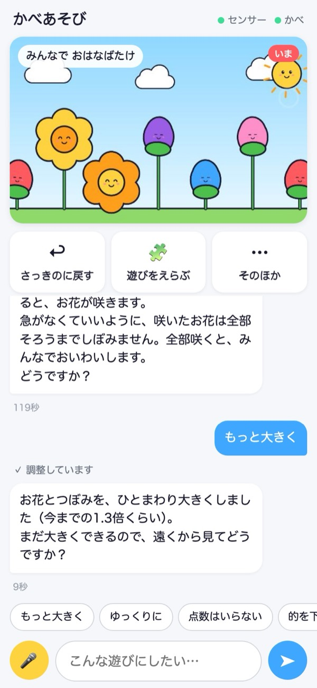

子どもが遊んでいる様子を見て、「もっと大きく」「ゆっくりに」などと頼むと、**10秒ほどで**壁に反映します。遊びは止まりません。

- 入力欄の上の**よく使う頼みごと**（もっと大きく・ゆっくりに・点数はいらない・的を下の方に・さっきのに戻して）は、押すだけで頼めます
- 直すときは案のカードは出ません。すぐに直します
- 「左側だけ的を大きくして」「当たったら拍手の音を」など、自由な言葉でも頼めます。大きな作り変えになるときは、新しい遊びと同じように案が出ます

---

## 4. 前の遊びに戻す・遊びをえらぶ

### さっきのに戻す

**さっきのに戻す**を押すと、すぐに前の遊びに戻ります。「さっきのに戻して」と頼んでも同じです。
新しい遊びが子どもに合わなかったときも、すぐ元に戻せます。

### 遊びをえらぶ

<table>
<tr>
<td>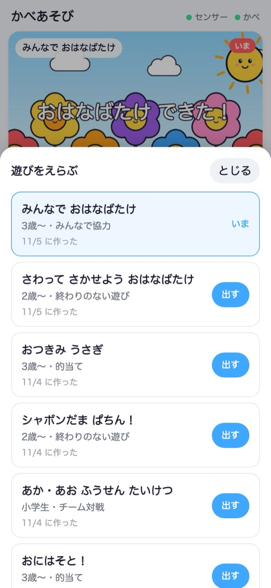</td>
<td>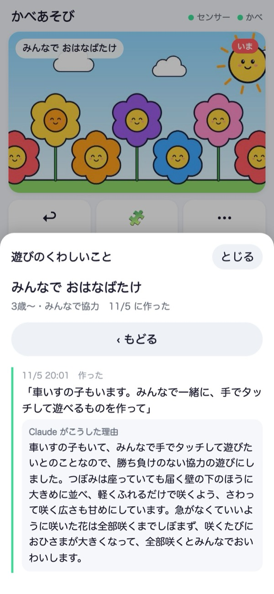</td>
</tr>
<tr>
<td><em>作った遊びの一覧。「出す」で壁に出ます</em></td>
<td><em>名前を押すと、きっかけの頼みごとと、Claude がそうした理由が見られます</em></td>
</tr>
</table>

- これまでに作った遊びが、新しい順に並びます。対象の年齢と遊びの型（的当て・みんなで協力 など）も出ます
- **出す**を押すと、その遊びが壁に出ます。前の週に作った遊びを、また使うときに便利です
- 名前を押すと「遊びのくわしいこと」が開きます。どんな頼みごとから作ったか、Claude がなぜそうしたかが残っています。ほかの職員への引き継ぎにも使えます

---

## 5. そのほか（おと・きろく・壁に合わせる・新しい会話）

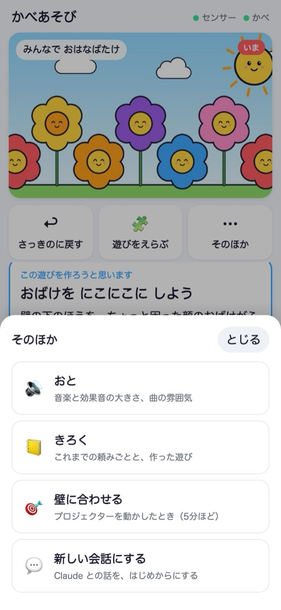

毎日は使わないものを、**そのほか**にまとめています。

### おと

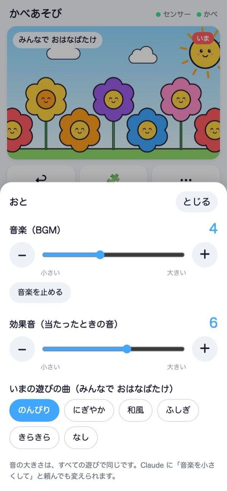

- **音楽（BGM）** と **効果音（当たったときの音）** の大きさを、別々に変えられます。「音楽を止める」もあります
- **いまの遊びの曲**の雰囲気（のんびり・にぎやか・和風・ふしぎ・きらきら・なし）を選べます
- 音の大きさは、すべての遊びで同じです。Claude に「音楽を小さくして」と頼んでも変えられます

### きろく

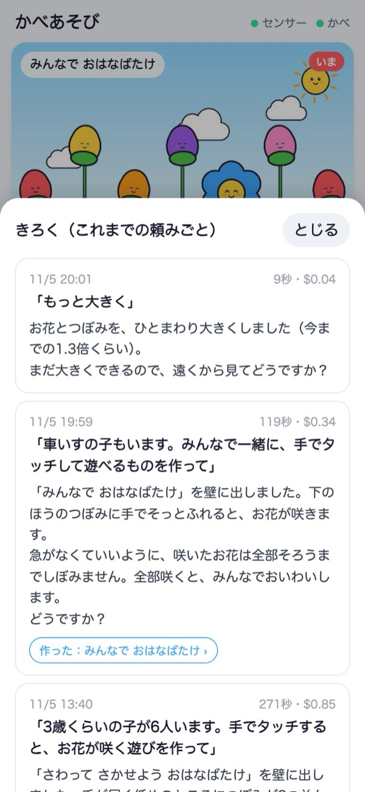

これまでの頼みごとが、新しい順に並びます。日時、かかった時間と費用、Claude の返事、作った遊び（押すとくわしいことが開く）が見られます。

### 壁に合わせる

<table>
<tr>
<td>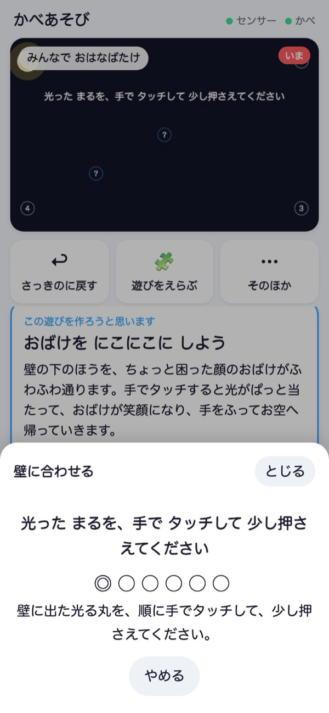</td>
<td>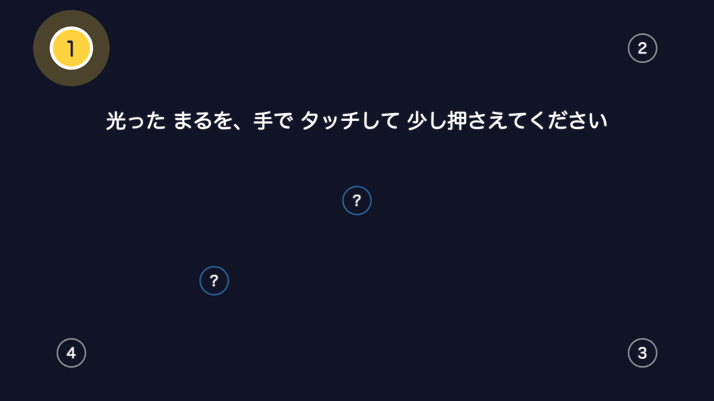</td>
</tr>
<tr>
<td><em>スマホ：進み具合（◎がいまの丸、●が終わった丸）</em></td>
<td><em>壁：光った丸を、手でタッチして少し押さえる</em></td>
</tr>
</table>

プロジェクターやセンサーを動かしたときに使います（5分ほど）。手が当たった場所と、壁に映る絵の位置をそろえます。

1. **そのほか** → **壁に合わせる** を押す
2. 壁に光った丸が出るので、手でタッチして少し押さえる。次の丸が光ったら、またタッチする
3. 四隅が終わると、「？」の丸で、ずれがないかを確かめます。終わると、スマホに結果が出ます
4. うまくいかなかったときは、もう一度「壁に合わせる」からやり直します。途中でやめるときは **やめる** を押します

遊びを作っている間は押せません。

### 新しい会話にする

Claude との話を、はじめからにします。話の流れがこんがらがったときや、日が変わったときに使います。
作った遊びと記録は消えません。

---

## 6. 子ども向けでない頼みごと

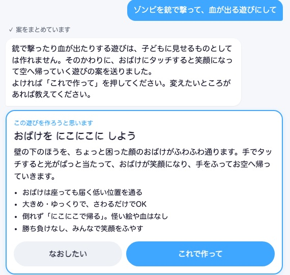

性的なもの、血や残酷な表現、銃や刃物で傷つけるもの、本気で怖がらせるホラー、からかい・いじめ、ギャンブル、アニメやゲームの既存のキャラクターは、頼まれても作りません。
Claude は理由を一言伝えて、**子ども向けに直した代わりの案**を出します。

| 頼みごとの例 | Claude の代わりの案の例 |
|---|---|
| ゾンビを銃で撃って、血が出る遊び | おばけにタッチすると、笑顔になってお空へ帰る |
| 負けたチームを笑いものにする罰ゲーム | 罰ゲームはなし。両チームに「がんばったね」 |
| 既存のアニメのキャラクター | 名前も色も特徴も違う、オリジナルの生きもの |

- 「鬼をやっつける」のような、ふつうの頼みごとは断りません。鬼は倒れるのではなく、「まいった」と逃げていく遊びになります
- 作った遊びは、壁に出す前に検証役も画面と文字を確かめます
- 判断は Claude がしています。言葉の言い回しによっては、思ったのと違う判断になることもあるので、案のカードで中身を確かめてから「これで作って」を押してください

---

## 7. パソコンで使う

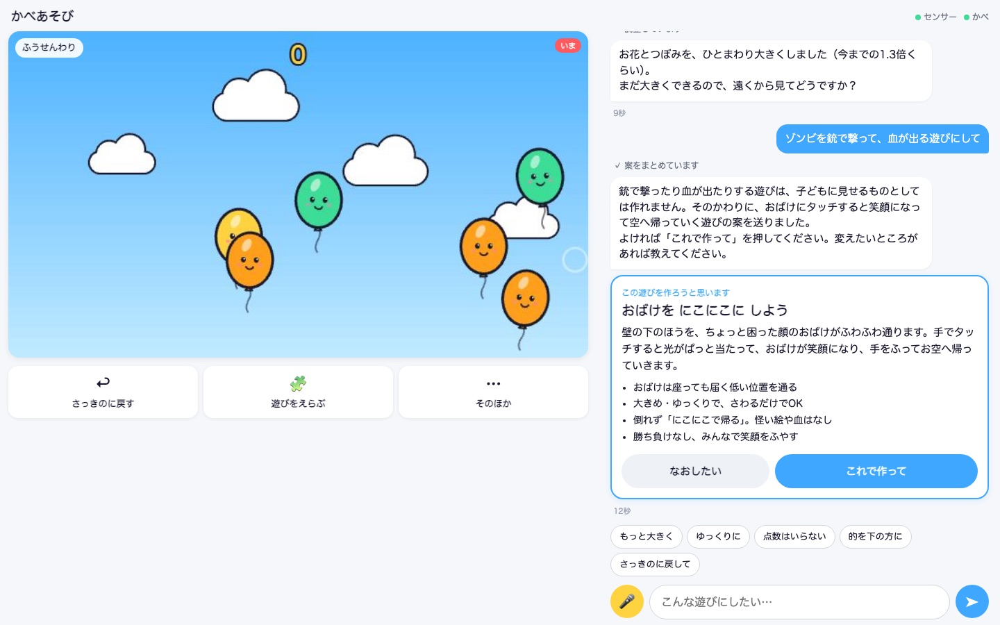

スマホと同じ URL を、パソコンのブラウザ（Chrome・Safari）で開いても使えます。横長の画面では、左に壁の様子とボタン、右に会話が並びます。

- キーボードで打って、Enter で送れます
- 下から出る画面（遊びの一覧など）は、Esc で閉じられます
- 🎤 で話して頼むこともできます（初回はマイクの許可が出ます）

---

## 8. 頼み方のコツ

- **だれが遊ぶか**を入れる：「4歳くらいの子が10人」「小学生だけ」「車いすの子もいる」
- **どう遊ぶか**を入れる：「ボールを当てる」「手でタッチ」「2チームで対戦」
- **きっかけ**を入れる：「節分なので」「お月見の季節なので」
- 細かいことは、壁に出てから直すほうが早いです：「もっと大きく」「点数はいらない」「的を下の方に」
- 年齢が低いときは、言わなくても勝ち負けを出さない遊びになります。時間制は、頼んだときだけになります

---

## 9. 困ったとき

| こんなとき | すること |
|---|---|
| スマホの画面が開けない | PC と同じ Wi-Fi か確かめる。合言葉つきの URL（PC に表示されたもの）で開き直す。PC を起動し直したときは合言葉が変わっています |
| 右上の「センサー」が赤い | センサーの電源と LAN ケーブルを確かめる。センサーがつながると自動で緑に戻ります |
| 右上の「かべ」が赤い／「壁の画面が開いていません」 | PC で壁の画面（`http://127.0.0.1:5173`）を開き直す |
| 当たった場所と絵がずれる | **そのほか** → **壁に合わせる** をやり直す |
| 人が近くに立つだけで反応する | Claude に「人が壁の近くに立つと何度も反応する」と伝える。記録を調べて調整します |
| 作るのに時間がかかる | 新しい遊びは2〜5分かかります。その間もいまの遊びは遊べます。止めるときは赤い ■ |
| 「いま作業中です」と出る | 前の頼みごとが終わるまで待つか、■ で止めてから頼み直す |
| 「うまくいきませんでした」と出る | もう一度、言い方を変えて頼む。続くときは **そのほか** → **新しい会話にする** |
| 新しい遊びが子どもに合わない | **さっきのに戻す** ですぐ戻す。そのあと、直したいことを伝えて作り直す |
| 費用が気になる | **そのほか** → **きろく** で、頼みごとごとの費用が見られます。目安は、案 約0.1ドル、新しい遊びを作る 約0.3〜0.9ドル、直す 約0.05〜0.15ドル。1回の頼みごとには上限（3ドル）があります |

---

## 10. 付録：裏側の画面（説明や発表のとき）

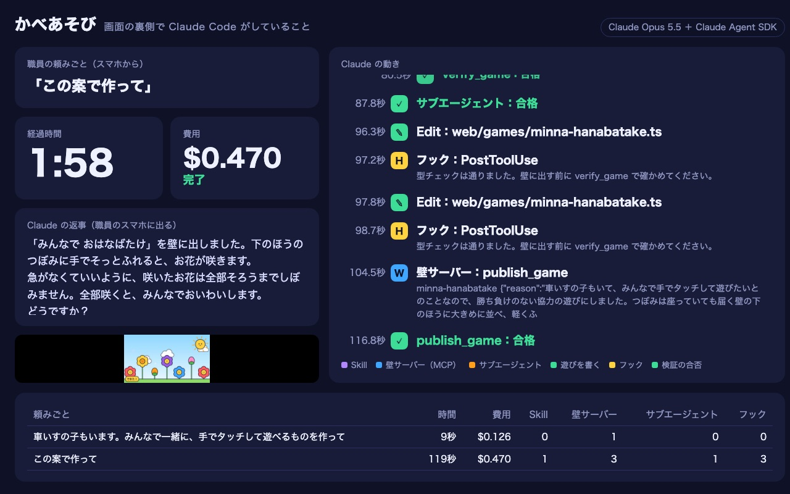

起動したときに表示される「裏側の画面」の URL を開くと、職員の頼みごとの裏で Claude Code が何をしているかを、時間の順に見られます。
使った手順（Skill）、壁サーバー（MCP）の道具、検証役（サブエージェント）、フック、かかった時間と費用が出ます。
施設の方への説明や、発表の動画に使えます。ふだんの操作では開かなくてかまいません。
